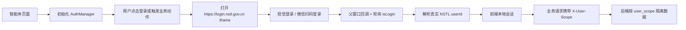

# NSTL 智能体平台统一登录接入手册

版本：2026-05-18 项目组内部复用版

本文档面向项目组内部智能体项目。目标是：只参考本 skill，即可完成 NSTL 统一登录认证、业务请求用户作用域传递、后端用户数据隔离和本地同站点联调。

本手册不依赖任何个人机器路径、本地设计文档或特定业务智能体源码。若你的项目存在本地假登录、测试账号登录或硬编码用户，应在接入时移除；本 skill 只沉淀正式 NSTL 统一认证链路。

如果只需要快速了解怎么复用本技能，先看 `README.md`；如果要真正改代码或做验收，以本手册和 `assets/templates/` 模板为准。

## 1. 固定结论

1. 登录入口统一使用 `https://login.nstl.gov.cn`。
2. 登录成功只认 NSTL 主站登录态接口：`GET /api/service/nstl/web/vilidate/isLogin`。
3. 前端校验登录态时必须使用 `credentials: 'include'` 携带同站点 Cookie。
4. 所有业务请求统一携带：`X-User-Scope: <真实 NSTL userId>`。
5. 后端所有用户数据必须按 `user_scope` 写入、查询、更新和删除。
6. 完整本地联调必须运行在 HTTPS 的 `*.nstl.gov.cn` 子域下。

注意：接口路径中的 `vilidate` 是当前 NSTL 接口实际路径拼写，接入时不要改成 `validate`。

## 2. 接入链路



新智能体只需要实现四个固定部分：

1. 前端认证模块：使用 `assets/templates/nstlAuth.ts`。
2. 前端入口初始化：参考 `assets/templates/main.ts.example`。
3. 前端业务请求：参考 `assets/templates/api-client.ts.example`。
4. 后端隔离：参考 `assets/templates/backend_auth.py`。

## 3. 登录成功标准

登录成功的唯一标准：

```text
GET /api/service/nstl/web/vilidate/isLogin
```

返回 `code === 0`，并且响应体中可以解析出真实用户 ID。

不能把以下情况当成登录成功：

- 登录弹窗关闭
- 前端 localStorage 存在某个对象或本地生成 token
- 微信扫码回调返回，但 `isLogin` 还没有返回真实用户
- `userId` 为 `default`
- `userId` 为 `unknown`
- `userId` 为 `mock_user_id`
- `userId` 以 `nstl_user_` 等临时前缀开头

建议识别的用户字段：

```text
userId / user_id / id / uid / loginId / account
```

建议识别的用户名字段：

```text
userName / username / name / realName / nickName / displayName
```

## 4. 固定接口与参数

### 4.1 登录页

```text
https://login.nstl.gov.cn
```

以前端 iframe 方式打开。

### 4.2 登录态接口

前端统一请求当前智能体自己的同站点代理：

```text
GET /api/service/nstl/web/vilidate/isLogin
```

请求要求：

```ts
fetch('/api/service/nstl/web/vilidate/isLogin?t=' + Date.now(), {
  method: 'GET',
  credentials: 'include',
  headers: {
    'X-Requested-With': 'XMLHttpRequest',
    'Cache-Control': 'no-cache',
    Pragma: 'no-cache',
  },
})
```

### 4.3 业务用户作用域

所有业务请求统一携带：

```text
X-User-Scope: <真实 NSTL userId>
```

前端拿不到真实用户时必须触发登录或终止用户相关操作，不得发送 `default` 或其他占位用户作用域。

### 4.4 微信扫码父窗口回调

父窗口必须暴露：

```ts
window.wxRegist = handleWxRegist
window.WxRegist = handleWxRegist
window.initWeichatLogin = handleInitWeichatLogin
```

NSTL 登录页中的微信脚本可能调用：

```ts
window.parent.wxRegist(response)
```

业务页面不要主动调用 `window.initWeichatLogin()`，它是给 iframe 内登录页重新初始化二维码时使用的兼容函数。

## 5. 前端接入步骤

1. 将 `assets/templates/nstlAuth.ts` 复制为项目内 `src/services/nstlAuth.ts`。
2. 在前端入口中调用 `createAuthManager(...)`。
3. 登录按钮调用 `getAuthManager().showLoginModal()`。
4. 生成任务或访问个人数据前调用 `requireUserScope()`。
5. 监听 `authSuccess` 和 `authLogout` 更新页面用户状态。
6. 所有用户相关业务请求统一设置 `X-User-Scope: await requireUserScope()`。
7. 移除本地假登录、测试账号登录、本地生成 token、硬编码用户和 `default` 用户作用域。

入口初始化示例见：

```text
assets/templates/main.ts.example
```

业务请求示例见：

```text
assets/templates/api-client.ts.example
```

## 6. 后端接入步骤

1. 所有用户相关接口读取 `X-User-Scope`。
2. 后端拒绝空值和非真实用户作用域。
3. 所有用户数据写入 `user_scope`。
4. 列表接口按 `user_scope` 查询。
5. 详情、更新、删除接口按 `task_id + user_scope` 查询。
6. 后端不得提供本地假登录或测试账号登录绕过链路。

FastAPI 示例见：

```text
assets/templates/backend_auth.py
```

## 7. 本地联调要求

NSTL 登录依赖同站点 Cookie。完整登录链路必须在 HTTPS 的 `*.nstl.gov.cn` 子域下测试。

推荐占位配置：

```text
https://<agent-local-host>.nstl.gov.cn:<frontend-port>
```

hosts 示例：

```text
127.0.0.1 <agent-local-host>.nstl.gov.cn
```

需要同步配置：

- hosts 映射
- 本地 HTTPS 证书
- Vite `allowedHosts`
- Vite HMR host
- 登录态接口代理 `/api/service/nstl`

Vite 示例见：

```text
assets/templates/vite.config.ts.example
```

## 8. 生产 Nginx 代理

生产前端网关必须代理登录态校验：

```nginx
location /api/service/nstl/web/vilidate/isLogin {
    proxy_pass https://www.nstl.gov.cn/api/service/nstl/web/vilidate/isLogin;
    proxy_set_header Host www.nstl.gov.cn;
    proxy_set_header Cookie $http_cookie;
    proxy_pass_header Set-Cookie;
    proxy_ssl_server_name on;
    proxy_ssl_verify off;
    proxy_connect_timeout 10s;
    proxy_read_timeout 30s;
}
```

完整片段见：

```text
assets/templates/nginx.conf.snippet
```

生产部署必须确认：

1. 页面通过 HTTPS 访问。
2. 页面域名属于 `nstl.gov.cn` 同站点体系。
3. `isLogin` 代理会转发 Cookie。
4. 不存在本地假登录、测试账号登录、硬编码用户或 `default` 用户作用域。
5. 后端拒绝空值和非真实用户作用域。

## 9. 移除非正式登录残留

若项目中已有本地假登录、测试账号登录、本地生成 token、硬编码用户或 `default` 用户作用域，接入正式 NSTL 认证时必须完成：

1. 初始化 `createAuthManager(...)`。
2. 将用户相关业务请求改为通过 `requireUserScope()` 获取真实用户。
3. 将登录入口替换为 `getAuthManager().showLoginModal()`。
4. 将生成任务、访问历史、删除、继续执行等操作前的鉴权替换为 `requireUserScope()`。
5. 删除本地假登录入口、测试账号登录接口、本地生成 token、硬编码用户和 `default` 用户作用域。
6. 保留 `/api/service/nstl/web/vilidate/isLogin` 同站点代理。
7. 使用 HTTPS 的 `*.nstl.gov.cn` 域名访问前端。

## 10. 验收清单

### 10.1 未登录状态

- 打开页面时不会生成真实用户会话。
- 点击生成任务会弹出 NSTL 登录 iframe。
- 业务请求未登录时不会写入真实任务数据。

### 10.2 短信登录

- iframe 能打开 `https://login.nstl.gov.cn`。
- 短信验证码流程能正常进入倒计时。
- 登录完成后 `isLogin` 返回 `code === 0`。
- 前端能解析出真实 `userId`。
- 本地会话写入真实用户。
- 后续业务请求携带 `X-User-Scope: <真实 userId>`。

### 10.3 微信扫码登录

- 二维码能正常显示。
- 父窗口暴露 `wxRegist`、`WxRegist`、`initWeichatLogin`。
- 扫码后不直接信任回调，而是继续等待 `isLogin`。
- `isLogin` 返回真实用户后关闭登录弹窗。

### 10.4 后端隔离

- 用户 A 创建的任务，用户 B 列表不可见。
- 用户 A 的任务详情，用户 B 用同一个 `task_id` 查询返回 404。
- 删除、继续执行、提交澄清都必须带 `task_id + user_scope`。
- `X-User-Scope` 为空或非真实用户时返回 401。

## 11. 常见问题

### 11.1 短信安全验证后没有倒计时

检查：

- 当前页面是否是 HTTPS 的 `*.nstl.gov.cn` 子域。
- hosts 是否正确映射。
- 本地证书是否匹配域名。
- iframe 是否被浏览器安全策略拦截。
- 是否误用 `localhost` 或 `127.0.0.1`。

### 11.2 微信扫码后一直转圈

检查：

- 父窗口是否暴露 `wxRegist`。
- 是否兼容 `WxRegist`。
- 是否暴露 `initWeichatLogin`。
- `isLogin` 是否仍未返回真实用户。
- 当前页面是否处于同站点 HTTPS 环境。

### 11.3 登录成功但业务接口仍返回 401

检查：

- 业务请求是否携带 `X-User-Scope`。
- 业务请求是否通过 `requireUserScope()` 获取真实用户。
- 项目中是否仍有本地假登录、测试账号登录或硬编码用户。
- `isLogin` 返回结构是否能解析出真实 `userId`。

### 11.4 本地正常，生产异常

检查：

- 生产域名是否 HTTPS。
- 生产域名是否属于 `nstl.gov.cn` 同站点体系。
- Nginx 是否保留 `isLogin` 代理。
- 是否仍残留本地假登录、测试账号登录或 `default` 用户作用域。

## 12. 内部复用边界

本 skill 面向项目组内部复用。为了让不同智能体都能直接调用和迁移，不应写入个人机器绝对路径、未脱敏凭据、固定本地域名或某个业务智能体的源码路径。所有跨项目示例应使用占位符或通用名称，例如：

- `<agent-local-host>.nstl.gov.cn`
- `<frontend-port>`
- `<backend-host>`
- `<backend-port>`
- `<agent-route-prefix>`

如果某个接入项目还有自己的补充设计文档，应在该项目内单独维护；本 skill 只沉淀统一登录认证的共性链路和可复用模板。
